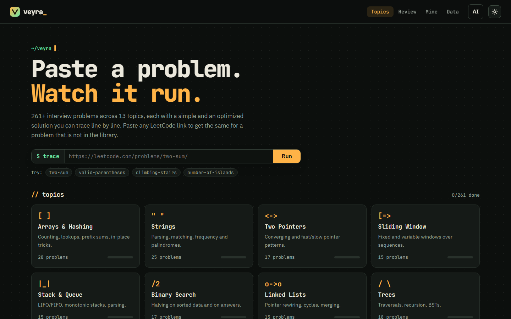
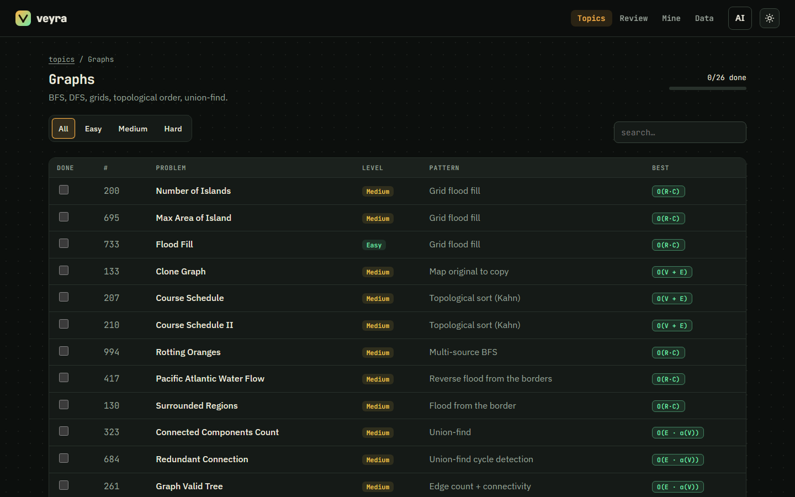
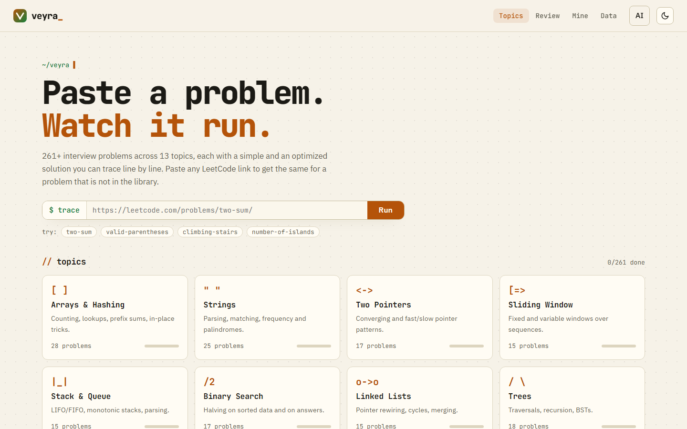

# veyra_

**Paste a problem. Watch it run.** Veyra is a code tracer and interview-practice library. Step
through real JavaScript line by line and watch variables, pointers, arrays, maps and sets change.
Every problem has a simple and an optimized solution, a diff between them, and a chart of how their
work grows with input size. Paste any LeetCode link to get the same treatment for a problem that is
not in the library.

Everything runs in your browser. Your code executes in a Web Worker, there is no backend, and no
account.

**Live demo:** https://aayushx1.github.io/veyra/

[](https://www.buymeacoffee.com/Aayushx1)



## What you get

- **261 problems across 13 topics.** Arrays & Hashing, Strings, Two Pointers, Sliding Window,
  Stack & Queue, Binary Search, Linked Lists, Trees, Graphs, Dynamic Programming, Heap/Greedy/
  Intervals, Backtracking, Math & Bits. Each has two solutions, edge-case tests, a memory hook, and a
  "where this shows up in real systems" note. Filter by difficulty, search by title, pattern, tag,
  number or LeetCode slug, and tick problems off as done.
- **Paste a LeetCode link.** A link or slug for a library problem opens it. For anything else, bring
  your own AI key and Veyra generates a page, then **runs both solutions on several inputs and only
  keeps the page if they run cleanly and agree**. See [AI generation](#ai-generation-and-privacy).
- **Live tracer.** Your code is instrumented and executed; every statement records a snapshot of the
  variables in scope. Step, scrub, play at 0.5x to 5x, or use the arrow keys and space bar. Edit the
  code or the input and it re-traces.
- **Debugger-style editor.** Syntax highlighting, the current line highlighted, and ghost hints that
  show what the previous line changed. A strip explains the active line with old to new values.
- **Data-aware views.** Arrays show per-cell change animation and colour-coded pointers (`lo`, `hi`,
  `i`, `mid`, ...) with the range between a low/high pair shaded. Maps, sets and objects render as
  tables and chips.
- **Diff and race.** A line diff turns the simple solution into the optimized one. A chart plots
  statements executed against input size, and a slider races the two as `n` grows.
- **Spaced repetition and Anki.** Built-in SM-2 review (a few new cards per session), a one-click
  `.txt` export, and a direct push to desktop Anki through AnkiConnect, with a setup guide.
- **Your data, portable.** Progress, review schedule and generated problems export to one JSON
  backup and import back. API keys are never included.
- **Shareable links** that carry your code and input in the URL.
- **Accessible and responsive.** Skip link, labelled controls, live regions, keyboard operation
  (Escape then Tab leaves the editor), light and dark themes, reduced-motion support, mobile layout.

<table>
  <tr>
    <td></td>
    <td></td>
    <td></td>
  </tr>
</table>

## Quick start

Requires Node.js 20 or newer.

```bash
git clone https://github.com/Aayushx1/veyra.git
cd veyra
npm ci
npm run dev        # http://localhost:5173
```

| Command             | What it does                                       |
| ------------------- | -------------------------------------------------- |
| `npm run dev`       | Start the dev server                               |
| `npm run build`     | Type-check and produce a production build in dist/ |
| `npm run preview`   | Serve the production build                         |
| `npm run lint`      | ESLint                                             |
| `npm run typecheck` | TypeScript                                         |
| `npm test`          | Unit and problem-library tests (Vitest)            |
| `npm run e2e`       | End-to-end tests (Playwright, builds first)        |

First time running e2e: `npx playwright install chromium`. No environment variables are required;
see `.env.example`.

## How it works

```
src/core/instrument.ts   acorn parses the source; a snapshot call is inserted before every statement
src/core/run.ts          runs the rewritten code with a step cap and an op cap
src/core/serialize.ts    bounded, cycle-safe snapshots of arrays, Map, Set and objects
src/core/worker.ts       Web Worker wrapper (terminated on timeout by src/lib/client.ts)
src/lib/                 router, store and backup, diff, SM-2, Anki, AI generation, share links
src/problems/            problem model, 13 data files, scale generators
src/components/          home, topics, problem page, editor, stepper, compare, race, diff, review
tests/ and e2e/          unit, library and browser tests
```

- **No editor or chart library.** A textarea over a highlighted layer, and an SVG chart. Runtime
  dependencies are React and acorn; fonts are self-hosted (see `THIRD_PARTY_NOTICES.md`).
- **Pure core.** The tracer has no DOM dependency, so the same code runs in the worker, in unit tests,
  and when verifying AI-generated pages.
- **Recording is capped, counting is not.** Up to 2,000 steps are recorded for playback; execution is
  counted up to 2,000,000 statements so the compare chart works on larger inputs.

### Quality gate for the library

Every problem is checked automatically (`tests/problemChecks.ts`): both solutions must run and
reproduce the expected output on the demo input and at least two extra cases, metadata must be valid,
and where a scale generator exists the optimized solution must execute fewer statements than the
simple one at the largest size. The catalog test also enforces unique ids, slugs and LeetCode numbers.

To add a problem, append a record to the right file in `src/problems/data/` and run `npm test`.

## AI generation and privacy

Used only for problems outside the library; everything else works offline.

- You supply a provider and key (Groq, Gemini, OpenRouter, OpenAI, Anthropic, or any OpenAI-compatible
  endpoint such as a local Ollama). Calls go **directly from your browser** to that provider. Only the
  problem name is sent.
- The key is held in `sessionStorage` and forgotten when the tab closes, unless you tick "remember on
  this device". It is never in backups or share links.
- The model's output is **executed and checked**: both solutions must run without errors and agree on
  every input, and the expected outputs are computed by running them rather than trusted from the
  model. It is still worth reading the code.
- Some providers block browser calls (CORS). Groq, Gemini and OpenRouter work from the browser.

## Limits and honest caveats

- **JavaScript only.** Python via Pyodide is on the roadmap.
- **The worker is a robustness boundary, not a hardened sandbox.** It stops hangs and keeps code off
  the page's DOM and storage. Network globals are shadowed as a courtesy, which determined code can
  bypass. Treat shared links like any code you were sent.
- **The compare chart counts statements, not time.** Work inside native calls (`sort`, `splice`,
  `String.replace`) counts as one statement, so it can understate cost. Use it to compare growth.
- Several pairs in the library differ in technique or memory rather than big-O; those have no chart.
- Values are truncated to 64 items per collection and 4 levels deep.
- The JS bundle is about 230 kB gzipped, mostly the problem library.

## Roadmap

- [ ] Python tracing via Pyodide (lazy-loaded)
- [ ] Tree and linked-list diagrams in the variables view
- [ ] Study paths (curated orders such as "first 30 problems")
- [ ] Split the problem library into lazily loaded chunks
- [ ] Step bookmarks and annotations

## Support

Veyra is free and runs entirely in your browser. If it helps you practise, you can
[buy me a coffee](https://www.buymeacoffee.com/Aayushx1). It is a plain link, so the app itself
loads no third-party scripts.

## License

MIT, see [LICENSE](LICENSE). Not affiliated with LeetCode; problem titles belong to their owners and
all explanations, solutions and visuals here are original. Font licenses:
[THIRD_PARTY_NOTICES.md](THIRD_PARTY_NOTICES.md).
