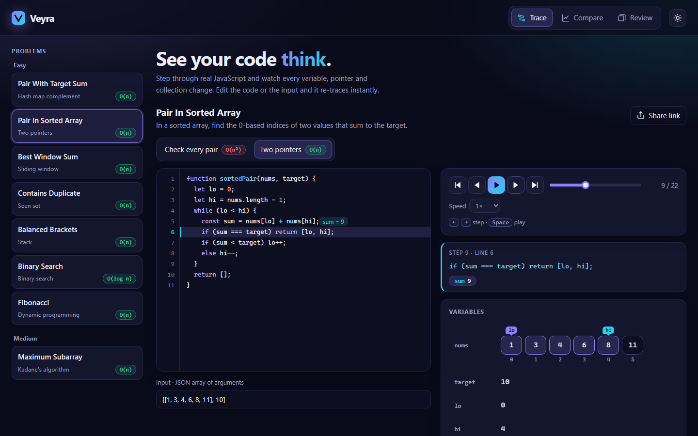
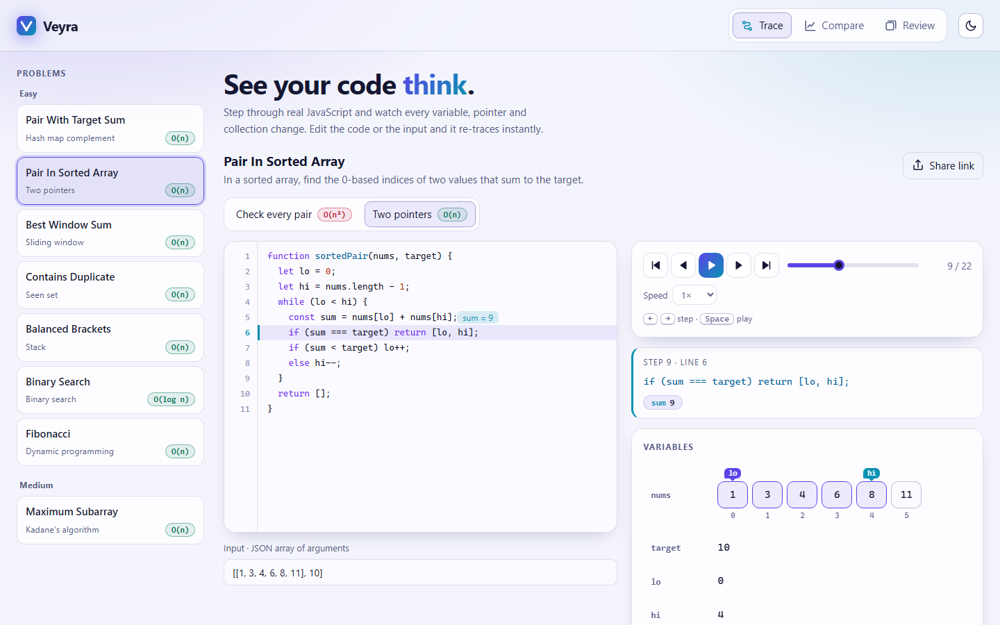
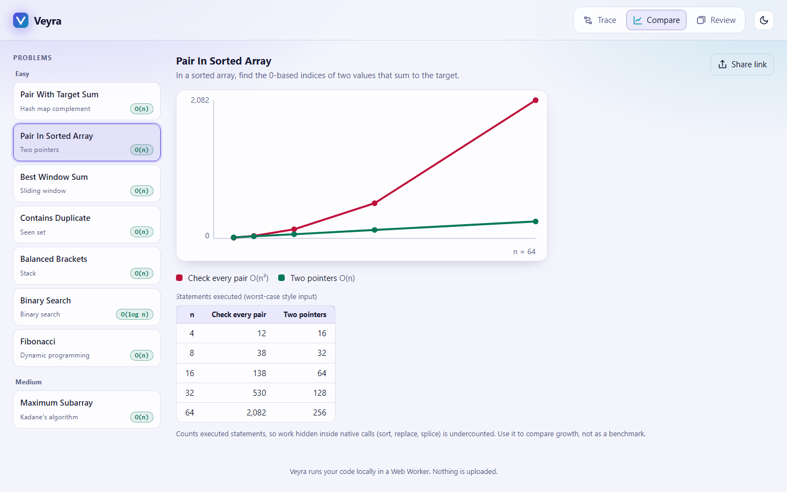
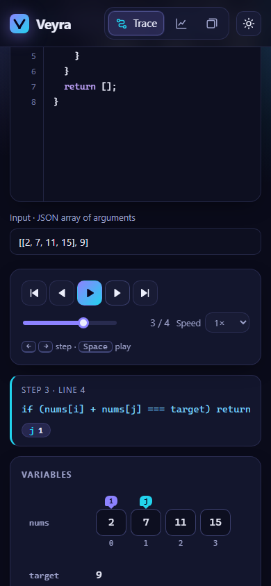

# Veyra

**Trace real code, step by step.** Edit a JavaScript solution, change its input, and watch variables,
arrays, pointers, maps and sets evolve line by line. Compare two approaches and see how their work
grows with input size. Then lock the pattern in with built-in spaced repetition.

Everything runs in your browser. Your code executes in a Web Worker, nothing is uploaded, and no
account or API key is needed.



## Features

- **Live tracer.** The code you type is instrumented and executed; every statement records a
  snapshot of the variables in scope. Step forward and back, scrub, play at 0.5x to 5x, or use the
  arrow keys and space bar.
- **Debugger-style editor.** Syntax highlighting, a highlighted current line, and inline ghost
  hints that show what the previous line changed (`sum = 9`). A "what just happened" strip shows the
  active source line and old to new values.
- **Data-aware views.** Arrays show per-cell change animation and colour-coded pointer markers
  (`lo`, `hi`, `i`, `mid`, ...), with the range between a low/high pair shaded. Maps, sets and
  objects render as tables and chips.
- **Editable inputs.** Inputs are a JSON array of arguments, validated with readable errors.
  Syntax errors and runtime errors point at the offending line.
- **Safe by construction.** Execution is isolated in a Web Worker with a statement budget and a hard
  timeout, so an infinite loop (even `while (true) {}`) cannot freeze the page.
- **Compare mode.** Runs the brute-force and optimized solutions across growing input sizes and
  charts statements executed, with an accessible data table.
- **Problem library.** Eight original problems, each with two solutions and test cases, covering hash
  maps, two pointers, sliding window, stacks, binary search, Kadane and dynamic programming.
- **Spaced repetition.** SM-2 scheduling, stored locally, plus one-click Anki export (tab-separated
  import file).
- **Shareable links.** The code and input are encoded in the URL hash.
- **Accessible and responsive.** Keyboard operable (Escape then Tab leaves the editor), labelled
  controls, live regions, light and dark themes, reduced-motion support, and a mobile layout.







## Quick start

Requires Node.js 20 or newer.

```bash
git clone https://github.com/Aayushx1/veyra.git
cd veyra
npm ci
npm run dev        # http://localhost:5173
```

| Command             | What it does                                       |
| ------------------- | -------------------------------------------------- |
| `npm run dev`       | Start the dev server                               |
| `npm run build`     | Type-check and produce a production build in dist/ |
| `npm run preview`   | Serve the production build                         |
| `npm run lint`      | ESLint                                             |
| `npm run typecheck` | TypeScript                                         |
| `npm test`          | Unit tests (Vitest)                                |
| `npm run e2e`       | End-to-end tests (Playwright, builds first)        |

First time running e2e: `npx playwright install chromium`.

No environment variables are required. See `.env.example`.

## How it works

```
src/core/instrument.ts   acorn parses the source; a snapshot call is inserted before every statement
                         (unbraced if/for/while bodies are wrapped in blocks). Scope names are tracked
                         so each snapshot reads only variables that are visible there.
src/core/run.ts          runs the rewritten code with a step cap and an op cap, returns steps + result
src/core/serialize.ts    bounded, cycle-safe snapshots of arrays, Map, Set and objects
src/core/worker.ts       Web Worker wrapper (terminated on timeout by src/lib/client.ts)
src/lib/                 view helpers, share links, SM-2 scheduler, Anki export
src/problems/            library and per-problem input scalers
src/components/          editor, stepper, value views, compare chart, review
```

Design notes:

- **No editor or chart library.** A textarea with a line gutter and an SVG chart keep the bundle
  small. The only runtime dependencies are React and acorn.
- **Pure core.** The tracer has no DOM dependency, so the same code runs in the worker and in unit
  tests.
- **Recording is capped, counting is not.** Up to 2,000 steps are recorded for playback; execution is
  counted up to 2,000,000 statements so compare mode still works on larger inputs.

## Limits and honest caveats

- **JavaScript only.** Python support (via Pyodide, lazy-loaded) is on the roadmap.
- **The worker is a robustness boundary, not a hardened sandbox.** It protects the UI thread from
  hangs and keeps code off the page's DOM and storage. Network globals are shadowed as a courtesy,
  which determined code can bypass. Only run code you are comfortable running in your own browser,
  and treat shared links the same way as any code you were sent.
- **Compare counts statements, not time.** Work inside native calls such as `sort`, `splice` or
  `String.replace` is counted as one statement. Use it to compare growth, not as a benchmark.
- **Snapshots are taken before each statement.** The state shown is what is about to be executed at
  that line.
- Values are truncated to 64 items per collection, 4 levels deep.

## Testing

- `tests/trace.test.ts`: instrumenter and runner (control flow, closures, destructuring, switch,
  try/catch, errors with line numbers, op and step limits, input validation).
- `tests/lib.test.ts`: every library solution against its cases, scaling behaviour, share-link
  round trip, SM-2 behaviour, Anki export format, view helpers.
- `e2e/app.spec.ts`: stepping, pointer rendering, error and infinite-loop handling, compare mode,
  share links, review and export, and a no-horizontal-overflow check. Runs on desktop and mobile
  Chrome profiles.

## Roadmap

- [ ] Python tracing via Pyodide (lazy-loaded)
- [ ] Tree and linked-list views
- [ ] Custom problems saved locally, with import and export
- [ ] Optional AI explanations (bring your own endpoint; keys kept out of storage)
- [ ] Step annotations and bookmarks

## License

MIT, see [LICENSE](LICENSE).
